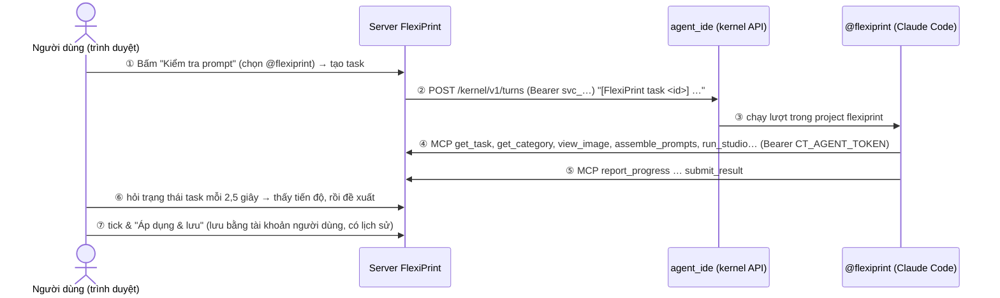

# @flexiprint trên agent_ide — tài liệu bàn giao

> **Người đọc:** admin agent_ide (anh sếp) **và agent của anh trên agent_ide**. Anh có thể đưa nguyên file này cho
> agent và nói "làm theo mục 5". Agent tự làm; chỉ dừng ở những chỗ ghi **[CẦN NGƯỜI]**.
>
> **Bên FlexiPrint:** An (`lehoangan1503`). Repo: `git@github.com:lehoangan1503/FlexiPrint.git`, nhánh `main`.

---

## 1. Mục đích

FlexiPrint (app tạo clipart in theo yêu cầu, `https://flexiprint.next.lc`) đang dùng Gemini Flash để viết / sửa /
kiểm tra prompt danh mục clipart. Flash đọc rời rạc, không hiểu cả hệ thống. Ta thay bằng agent **@flexiprint**
chạy trên agent_ide (Claude Code, gói thuê bao của công ty):

- **Chiều ngược** — người dùng bấm nút trên app FlexiPrint → việc được giao cho @flexiprint → kết quả quay về app
  để người dùng duyệt.
- **Chiều xuôi** — người trong công ty chat "@flexiprint …" trên agent_ide → agent làm việc thẳng trên FlexiPrint.

Cả hai chiều, agent nhìn toàn bộ hệ thống qua **flexiprint-mcp** (MCP server của FlexiPrint).

---

## 2. Sơ đồ

```
 ┌──────────────── ① Trình duyệt ────────────────┐   ┌──────────── ② Server FlexiPrint ─────────────┐   ┌──────── ③ agent_ide (máy công ty) ────────┐
 │ Dialog danh mục: Tạo / Cập nhật / Kiểm tra     │   │ ct_agent_tasks — hàng đợi việc                │   │ Kernel API /kernel/v1  (token svc_…)       │
 │ Công tắc  [Flash | @flexiprint ●]              │─①▶│   pending → running → done / failed           │─②▶│        │ ③ chạy lượt                        │
 │                                                │   │                                               │   │        ▼                                    │
 │ Panel duyệt: tick → Áp dụng & lưu         ◀─⑥──│───│ flexiprint-mcp  /api/customize-tool/mcp ◀──④──│───│ @flexiprint (Claude Code)                  │
 │        │ ⑦                                     │   │   (Bearer CT_AGENT_TOKEN)                 ◀──⑤──│───│  docs/agent.md + skills                    │
 │        ▼                                       │   │ DB Supabase + lịch sử · ComfyUI (tạo ảnh)     │   │        ▲                                    │
 └────────┴───────────────────────────────────────┘   └───────────────────────────────────────────────┘   │ Người trong công ty chat "@flexiprint …"   │
                                                                                                          └────────────────────────────────────────────┘
```



Bản vẽ tldraw: `docs/architecture/flexiprint-chieu-nguoc.tldr` (app → agent → app) và `docs/architecture/flexiprint-chieu-xuoi.tldr` (nhờ thẳng @flexiprint).

---

## 3. Cơ chế hoạt động

### Chiều ngược (app → agent → app)
1. **①** Người dùng mở một danh mục trên app, chọn **@flexiprint** ở công tắc, bấm *Tạo bằng AI* / *Cập nhật bằng AI*
   / *Kiểm tra prompt*. App ghi một dòng vào bảng `ct_agent_tasks` (loại việc, danh mục, nhận xét, ảnh — dạng URL).
2. **②** Server FlexiPrint gọi `POST {AGENT_IDE_URL}/kernel/v1/turns` bằng token dịch vụ `svc_…`. Tin nhắn chỉ nói
   "có task id X". Mỗi danh mục dùng lại **một phiên** của agent → agent nhớ những gì đã thử ở danh mục đó.
3. **③** agent_ide chạy một lượt Claude Code trong project `flexiprint` (skill `flexiprint-task`).
4. **④** Agent gọi ngược FlexiPrint qua MCP bằng `CT_AGENT_TOKEN`: đọc task, danh mục, lịch sử, xem ảnh, xem prompt
   đã ghép đúng như model ảnh nhận, tạo ảnh thử khi cần.
5. **⑤** Agent báo tiến độ (`report_progress`) và nộp kết quả (`submit_result`) hoặc bỏ (`fail_task`). agent_ide
   không có webhook báo xong — `submit_result` chính là "cuộc gọi báo lại".
6. **⑥** App hỏi trạng thái task, hiện tiến độ từng dòng, rồi hiện **đề xuất** dạng ô tick (như Flash vẫn làm).
   Nếu lượt của agent kết thúc mà không nộp (hoặc treo quá 3 giờ) → task báo lỗi.
7. **⑦** Người dùng tick và áp dụng → app lưu bằng **tài khoản của chính người dùng**. Agent không tự lưu trong việc
   đến từ app.

### Chiều xuôi (agent_ide → FlexiPrint)
Người trong công ty chat "@flexiprint sửa lỗ treo của Chibi Car…" (skill `flexiprint-category`). Agent đọc, đề xuất
bản trước / sau, **hỏi người nhờ đồng ý**, rồi lưu bằng `save_category` / `save_preset`. Mỗi lần lưu có một dòng lịch
sử (trước / sau / ai nhờ / vì sao) và `restore_category` đưa về bản cũ được. Agent không xoá gì.

Khi agent_ide không trả lời, app vẫn dùng Flash như cũ.

---

## 4. Token, khoá và biến môi trường

| Tên | Ai tạo | Để ở đâu | Dùng để |
|---|---|---|---|
| `CT_AGENT_TOKEN` (`fpa_…`) | An (đã tạo) | `.env` server FlexiPrint **và** header của capability `flexiprint` trên agent_ide (mục 5.4) | Chìa để **agent vào FlexiPrint** (MCP). An gửi **riêng**, không nằm trong repo |
| `svc_…` (`AGENT_IDE_TOKEN`) | Admin agent_ide (mục 5.5) | `.env` server FlexiPrint | Chìa để **FlexiPrint gửi việc cho @flexiprint**; chỉ trong thư mục project này, không giới hạn lượt, thu hồi được |
| `AGENT_IDE_URL` | Admin agent_ide | `.env` server FlexiPrint | Địa chỉ public của agent_ide (Cloudflare Tunnel), không có `/` cuối |
| Deploy key GitHub (`flexiprint_deploy`) | An (đã tạo + gắn lên GitHub) | Khoá riêng: gửi riêng → `~/.ssh/` máy agent_ide; khoá công khai trên GitHub | Kéo code FlexiPrint về (chỉ đọc, một repo), không hết hạn tới khi gỡ |

Đã có sẵn bên FlexiPrint, không cần làm gì: `SUPABASE_SERVICE_ROLE_KEY`, `CT_COMFY_TOKEN`.

---

## 5. Việc trên máy agent_ide (agent làm theo thứ tự)

Quy ước: `REPO` = nơi để code FlexiPrint, đề xuất `~/code/FlexiPrint` (Windows: `%USERPROFILE%\code\FlexiPrint`).
Project của agent = `REPO/integrations/agent-ide/flexiprint` — chính thư mục trong repo, nên `git pull` là agent
có ngay bản khai và skill mới.

### 5.1 Khoá đọc repo (deploy key, không hết hạn)
An đã tạo sẵn khoá và gắn lên GitHub (chỉ đọc, chỉ repo FlexiPrint, không hết hạn — gỡ trên GitHub là thu hồi).
An gửi riêng thư mục `secrets/` gồm `flexiprint_deploy` (khoá riêng) và `.env.agent-ide.local` (token MCP).
Không cần gửi gì lại cho An.

Đặt khoá vào máy agent_ide:
- **Linux / macOS**
  ```bash
  mkdir -p ~/.ssh && cp flexiprint_deploy ~/.ssh/flexiprint_deploy && chmod 600 ~/.ssh/flexiprint_deploy
  ```
- **Windows (PowerShell)**
  ```powershell
  New-Item -ItemType Directory -Force $HOME\.ssh | Out-Null
  Copy-Item flexiprint_deploy $HOME\.ssh\flexiprint_deploy
  icacls $HOME\.ssh\flexiprint_deploy /inheritance:r /grant:r "$($env:USERNAME):R"
  ```

Thêm vào `~/.ssh/config` (Windows: `%USERPROFILE%\.ssh\config`):
```
Host github-flexiprint
  HostName github.com
  User git
  IdentityFile ~/.ssh/flexiprint_deploy
  IdentitiesOnly yes
```
Kiểm: `ssh -T github-flexiprint` → "Hi lehoangan1503/FlexiPrint! You've successfully authenticated…".

### 5.2 Lấy code + tự cập nhật
```bash
git clone github-flexiprint:lehoangan1503/FlexiPrint.git ~/code/FlexiPrint
```
Tự kéo code mới mỗi 10 phút (chỉ fast-forward; không bao giờ ghi đè gì):
- **Linux (systemd user timer)** — hoặc đơn giản bằng cron: `*/10 * * * * git -C ~/code/FlexiPrint pull --ff-only -q`
- **Windows (Task Scheduler)**:
  ```powershell
  schtasks /Create /SC MINUTE /MO 10 /TN FlexiPrintPull /TR "git -C %USERPROFILE%\code\FlexiPrint pull --ff-only -q"
  ```
Thư mục project có `.gitignore` riêng cho thứ agent / agent_ide ghi vào (`notes/`, `agent/`, `.agent-jobs/`…),
nên `git pull` không bị vướng.

### 5.3 Thêm project @flexiprint
Thư mục `REPO/integrations/agent-ide/flexiprint` đã có sẵn `docs/agent.md` (bản khai) và `.claude/skills/` → chỉ
cần **mở thư mục đó như một project** (UI: Mở project; API admin: `POST /api/projects/open {"cwd": "<đường dẫn tuyệt đối>"}`).
**Không** bấm "Thăng agent" (nó báo đã có bản khai). Kiểm: danh sách agent có **@flexiprint**.

Bản khai: Claude, `acceptEdits`, không bash, chỉ trong thư mục này, không giới hạn lượt (sửa trong `docs/agent.md` qua
repo FlexiPrint nếu cần).

### 5.4 Gắn MCP flexiprint (capability)
Thêm vào `~/.http-agent-ide/claude-tool-catalog.json`, trong `capabilities` (tạo file bằng bản copy của
`server/config/claude-tool-catalog.json` nếu chưa có), khối trong `flexiprint-capability.json` cạnh file này,
thay `<CT_AGENT_TOKEN của FlexiPrint>` bằng token An gửi riêng **[CẦN NGƯỜI: nhận token]**:
```json
"flexiprint": {
  "label": "FlexiPrint — thư viện clipart, studio tạo ảnh, task từ app FlexiPrint",
  "short": "FlexiPrint library + studio",
  "tools": [],
  "mcpServers": {
    "flexiprint": {
      "type": "http",
      "url": "https://flexiprint.next.lc/api/customize-tool/mcp",
      "headers": { "Authorization": "Bearer fpa_…" }
    }
  }
}
```
Rồi **cài sẵn** cho project (trường `capabilities:` trong `agent.md` hiện không được đọc — phải cài ở project):
UI Cài đặt → project flexiprint → capability `flexiprint` = bật; hoặc API admin
`POST /api/settings/project/capability {"cwd": "<thư mục project>", "id": "flexiprint", "on": true}`.

### 5.5 Token dịch vụ cho FlexiPrint
UI Cài đặt → Dịch vụ → thêm; hoặc API admin
`POST /api/services {"name": "flexiprint", "folder": "<thư mục project>", "dailyTurnLimit": 0}` → lấy `token`
(`svc_…`). **[CẦN NGƯỜI]** Gửi **riêng** cho An: token `svc_…` + địa chỉ public agent_ide.

### 5.6 Kiểm tra
1. Chat với @flexiprint: "liệt kê danh mục FlexiPrint" → nó gọi `mcp__flexiprint__list_categories` và trả danh sách.
2. `curl -H "Authorization: Bearer svc_…" https://<agent_ide>/kernel/v1/ping` → `ok: true`, `card.name = "flexiprint"`.
3. Sau khi An cấu hình xong (mục 6): trên app FlexiPrint mở Chibi Car → Cập nhật bằng AI → chọn @flexiprint →
   Kiểm tra prompt → thấy tiến độ, rồi đề xuất.

---

## 6. Việc bên FlexiPrint (An)

1. Chạy trên Supabase: `supabase/migrations/011_agent_tasks.sql`, `012_agent_writes.sql`.
2. `.env` server FlexiPrint: `CT_AGENT_TOKEN=fpa_…` (đã có trong `integrations/agent-ide/secrets/.env.agent-ide.local`),
   `AGENT_IDE_URL=…`, `AGENT_IDE_TOKEN=svc_…` (từ mục 5.5). Deploy.
3. Gắn khoá công khai `secrets/flexiprint_deploy.pub` lên GitHub (Settings → Deploy keys, không cho ghi), rồi gửi
   riêng thư mục `secrets/` cho admin agent_ide.

---

## 7. MCP flexiprint

| Nhóm | Tool |
|---|---|
| Thư viện | `list_categories`, `get_category`, `list_cliparts`, `get_history`, `view_image`, `list_style_packs`, `list_materials`, `list_product_details` |
| Prompt | `assemble_prompts` (prompt y như model ảnh nhận, kể cả bản nháp), `review_category` |
| Studio | `list_models`, `run_studio` (origin / refine / variant / material — **tốn tiền**), `get_run` |
| Task từ app | `get_task`, `report_progress`, `submit_result`, `fail_task` |
| Lưu (khi được nhờ trực tiếp) | `save_category`, `save_preset`, `restore_category` |

Resources: `flexiprint://guide/overview` (đọc đầu tiên), `…/task-results`, `…/category-rules`, `…/details-rules`,
`…/revise-rules`, `…/review-rules` — cùng luật mà AI có sẵn của FlexiPrint dùng.

### Quyền hiện tại
- `CT_AGENT_TOKEN` là **một** danh tính "agent" cho cả máy agent_ide: ai chat được với @flexiprint thì nhờ được nó.
- Việc từ app: người tạo task là tài khoản FlexiPrint đã đăng nhập; lưu luôn do chính họ bấm.
- Việc nhờ trực tiếp: ghi lịch sử "agent:flexiprint" + tên người nhờ **do agent tự khai** (chưa xác thực).
- Chốt khi lưu: kiểm tra như app, không ghi đè nếu vừa có người sửa, không lưu khi danh mục đang có task từ app,
  preset dùng chung phải xác nhận, không xoá.

---

## 8. Thu hồi / đổi khoá

| Muốn | Làm |
|---|---|
| Chặn agent vào FlexiPrint | An đổi `CT_AGENT_TOKEN` trong `.env` FlexiPrint, deploy → gửi token mới cho agent_ide |
| Chặn FlexiPrint gửi việc | Admin agent_ide: Dịch vụ → xoay token / tắt dịch vụ `flexiprint` |
| Chặn kéo code | An gỡ deploy key "agent_ide flexiprint" trên GitHub (Settings → Deploy keys) |

## 9. Sự cố thường gặp

| Hiện tượng | Nguyên nhân / cách xử lý |
|---|---|
| Công tắc trên app chấm đỏ | `AGENT_IDE_URL` sai / agent_ide tắt / token `svc_` bị xoay → `curl …/kernel/v1/ping` |
| Agent không thấy tool `mcp__flexiprint__*` | Capability chưa cài cho project (5.4) hoặc token sai (MCP trả 401) |
| Task báo "đã xong lượt nhưng không nộp kết quả" | Xem phiên đó trên agent_ide; thường do lỗi định dạng `submit_result` |
| `save_category` báo "saved at …" | Có người vừa sửa → agent đọc lại rồi làm lại (đúng thiết kế) |
| `git pull` lỗi | Có file theo dõi bị sửa tay trong thư mục project → `git -C ~/code/FlexiPrint status`, hoàn tác thay đổi đó |
